

<b>Turn Premiere Pro's native mask tracking into Transform keyframes, in a few clicks.</b>

  <a href="../../releases/latest">Download</a> ·
  <a href="#tutorials">Video tutorials</a> ·
  <a href="docs/guides/MecTracker-Guide_en-us.pdf">User guide (PDF)</a> ·
  <a href="README.pt-BR.md">🇧🇷 Leia em português</a>

> [!IMPORTANT]
> **Works only in Adobe Premiere Pro 2026 (version 26.0) or later.** It does not work in Premiere Pro 2025 or older.

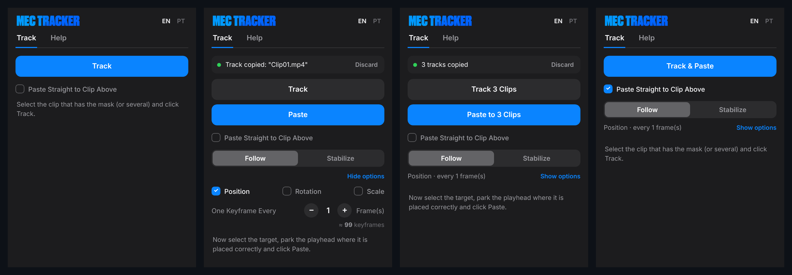

Mec Tracker is a free, open source panel for **Adobe Premiere Pro 2026**. Track a mask with Premiere's own tracker. Then let Mec Tracker turn that motion into **Transform** keyframes on a text, image, graphic or Nest, so the target follows the object. It can also do the opposite and **stabilize** the shot.

## Features

- **Follow or Stabilize**: the target moves with the object, or against it to hold the object still.
- **Position, Rotation and Scale**: copy any mix of the three.
- **One keyframe every N frames**: 1 is the most accurate; higher numbers give smoother motion with fewer keyframes.
- **Paste Straight to Clip Above**: track and paste onto the clip on the track above in one click.
- **Several clips at once**: track many masks in one go, then paste each track onto the targets you pick.
- **Guided panel**: the blue button is always the next step, and the buttons show how many clips are selected.
- **Update notice**: the panel tells you when a new version is out here on GitHub.
- English and Portuguese interface.

## How it works

| 1. Track | 2. Paste |
|---|---|
| 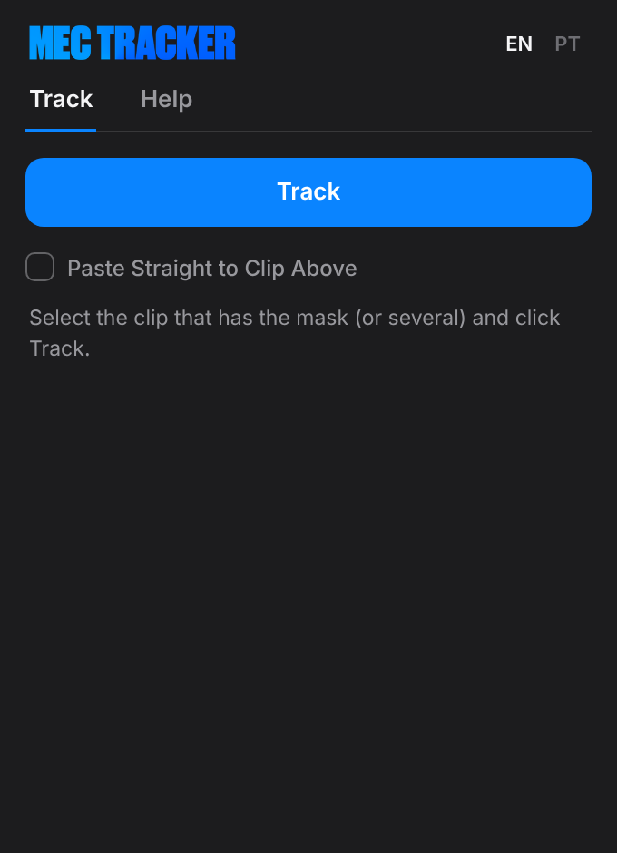 | 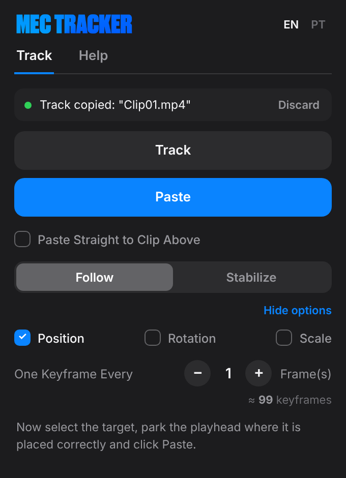 |
| On the clip with the object, create a mask and track it with Premiere (*Track selected mask forward*). Select that clip and press **Track**. | Select the target (text, image, graphic…), park the playhead where it is placed correctly and press **Paste**. Mec Tracker adds the Transform effect with the keyframes. |

| Several clips | Paste Straight to Clip Above |
|---|---|
| 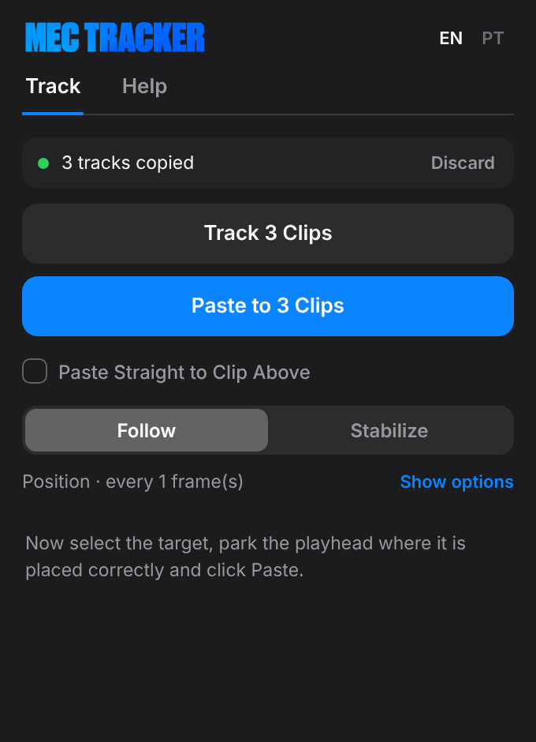 | 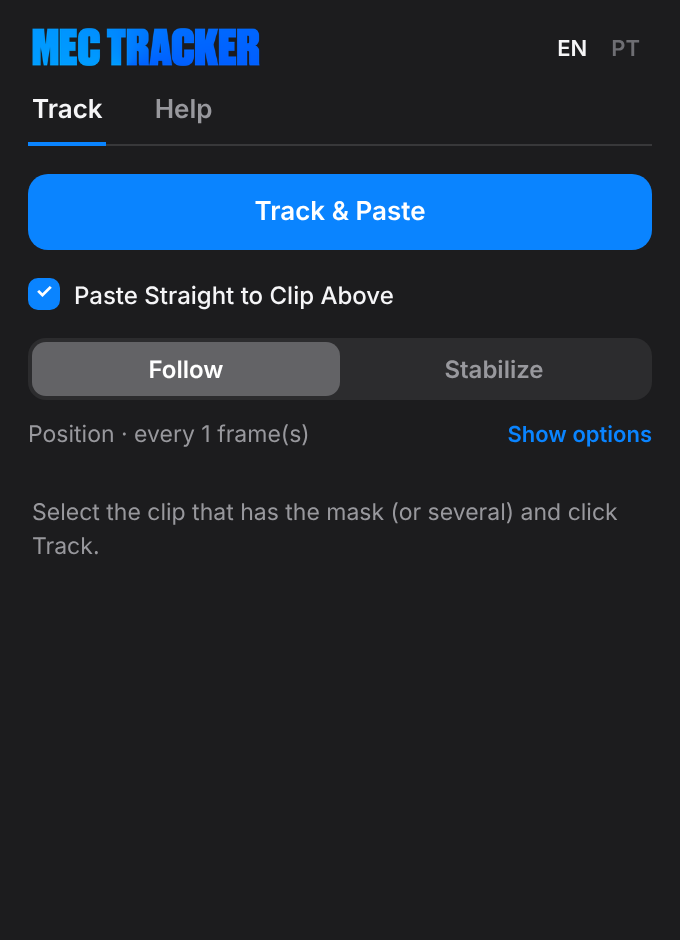 |
| Select several masked clips and press **Track 3 Clips**. Then select the targets and press **Paste to 3 Clips**. Each target gets the track of the clip it overlaps most in time. | Tick the box and the button becomes **Track & Paste**. Mec Tracker tracks each selected clip and pastes onto the clip right above it. |

Want a cleaner panel? Use **Hide options** to fold Position/Rotation/Scale and the interval into a one-line summary. The full step-by-step guide is in [docs/guides](docs/guides/MecTracker-Guide_en-us.pdf), and the same tips are in the panel's **Help** tab.

## Tutorials

Short videos with zoom and captions in English and Portuguese. Click a title to open it.

<b>1. Open the panel</b> · Window > UXP Plugins > Mec Tracker.

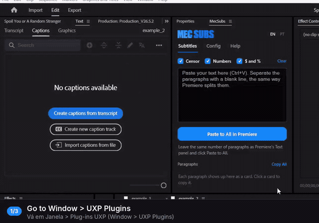

<b>2. Make a mask by hand</b> · Rectangle or Pen mask on the object, then track it forward with Premiere.

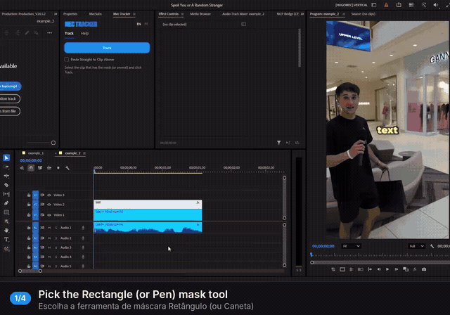

<b>3. Automatic mask with Object Mask</b> · Click the object and Premiere masks it. Keep the Object Mask inside Opacity.

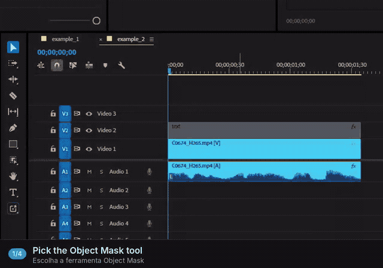

<b>4. Track, then Paste</b> · Track the masked clip, select the target and click Paste.

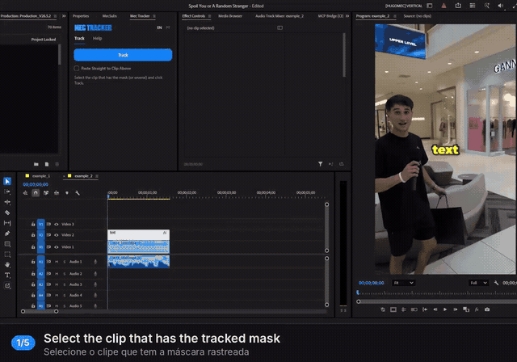

<b>5. Paste Straight to Clip Above</b> · One click tracks and pastes onto the clip on the track above.

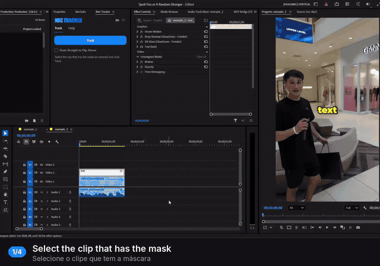

<b>6. Mask, Nest and Paste Straight</b> · Nest the graphic so it moves as one piece, then Track & Paste.

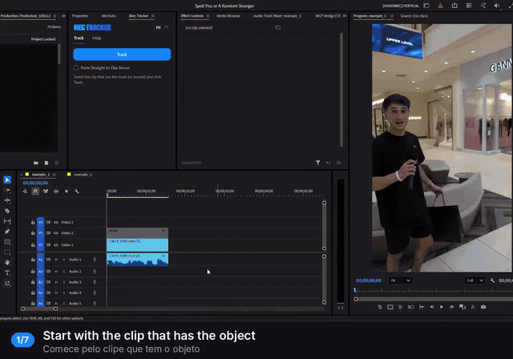

<b>7. Several clips: Track and Paste</b> · Track 5 clips at once, then paste onto 5 targets.

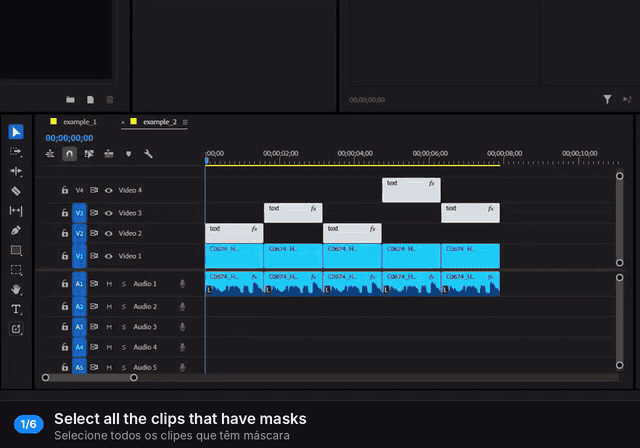

<b>8. Several clips: Paste Straight</b> · Track & Paste 5 clips, one at a time, onto the clips above.

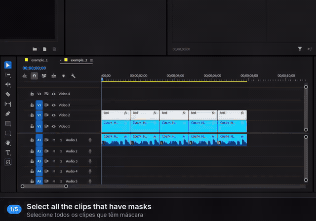

<b>9. Stabilize a shot</b> · Track a point (the face) and paste with Stabilize on the same clip.

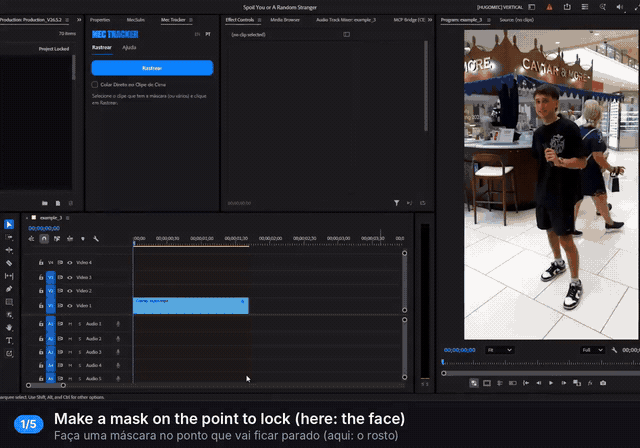

The same videos, in MP4, come in the **Tutoriais** folder of the [download](../../releases/latest).
## Install

1. Download the latest `MecTracker_x.y.z.zip` from [Releases](../../releases/latest) and unzip it.
2. **Windows**: double-click `Install-Windows.bat` and accept the administrator prompt.
   **Mac**: open Terminal, type `bash `, drag `Install-Mac.command` into the window and press Enter.
3. Restart Premiere Pro and open **Window > UXP Plugins > Mec Tracker**.

Manual install (Windows): copy the `com.mectracker` folder to `C:\Program Files\Common Files\Adobe\UXP\Plugins\External\`.

Installing a new version is the same: run the installer again. It replaces the old version.

## Updates

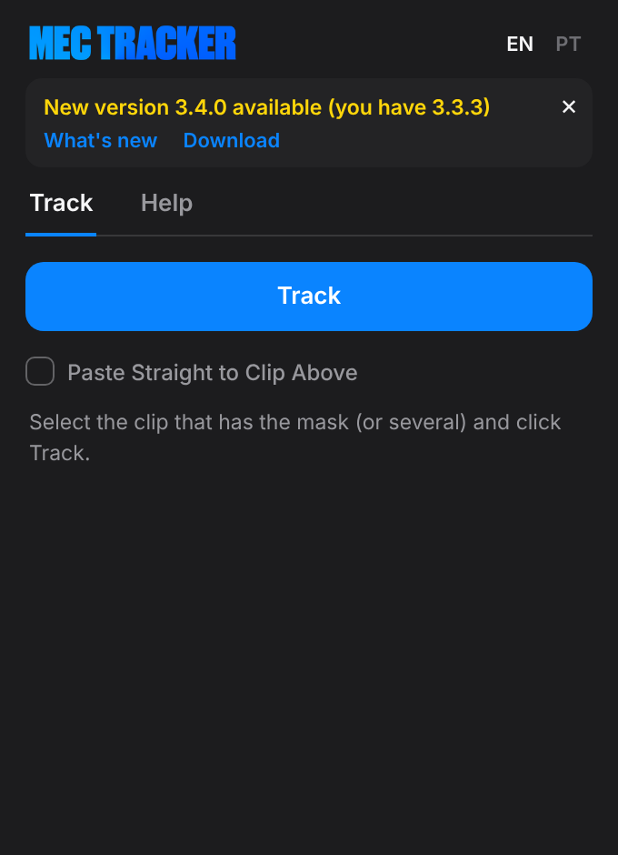

When a new release is published here, the panel shows the new version number, a **What's new** button with the release notes and a **Download** link. It checks GitHub every 30 minutes while the panel is open. To check right away, click **Check for updates** at the end of the Help tab.

## Requirements and limits

- Adobe Premiere Pro 2026 (version 26.0 or later), Windows or Mac.
- Clips with changed speed (not 100%) are not supported as targets yet.
- If the mask is in *Unassigned Masks*, save the project (Ctrl+S / Cmd+S) before tracking.

## Something went wrong?

Open the **Help** tab, click **Log**, then **Copy**. Then [open an issue](../../issues) with the log pasted in.

## For developers

The plugin is plain UXP (manifest v5) with no build step: everything is in [`com.mectracker`](com.mectracker). To try changes, load that folder in the **UXP Developer Tool**. `tools/guide` rebuilds the PDF guides and screenshots from the real panel.

When you publish a release, bump the version in `manifest.json`, in `VERSION` inside `index.js`, at the end of the Help tab (`plugin-ver` in `index.html`) and in both installers. Then tag it `vX.Y.Z` so the update notice picks it up.

## License

[MIT](LICENSE): free to use, change and share.

## Credits

Created by **Hugo Mec** · [@hugoeditor_](https://x.com/hugoeditor_)
