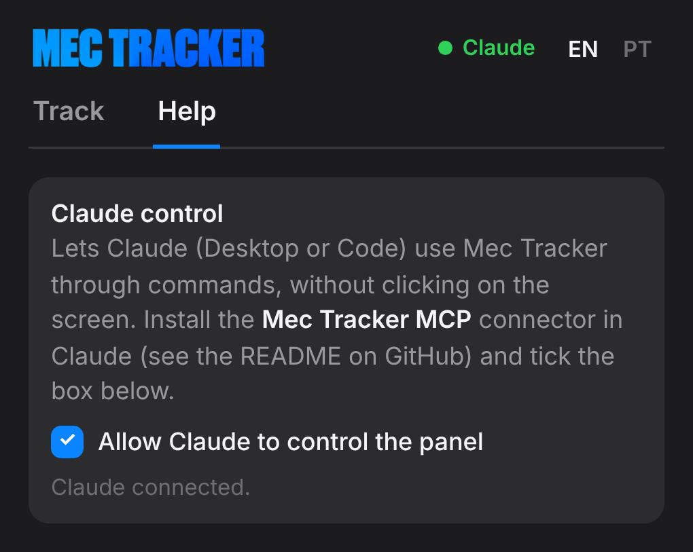

<b>Turn Premiere Pro's native mask tracking into Transform keyframes, in a few clicks.</b>

  <a href="../../releases/latest">Download</a> ·
  <a href="#tutorials">Video tutorials</a> ·
  <a href="docs/guides/MecTracker-Guide_en-us.pdf">User guide (PDF)</a> ·
  <a href="README.pt-BR.md">🇧🇷 Leia em português</a>

> [!IMPORTANT]
> **Works only in Adobe Premiere Pro 2026 (version 26.0) or later.** It does not work in Premiere Pro 2025 or older.

Mec Tracker is a free, open source panel for **Adobe Premiere Pro 2026**. Track a mask with Premiere's own tracker. Then let Mec Tracker turn that motion into **Transform** keyframes on a text, image, graphic or Nest, so the target follows the object. It can also do the opposite and **stabilize** the shot.

## Features

- **Follow or Stabilize**: the target moves with the object, or against it to hold the object still.
- **Position, Rotation and Scale**: copy any mix of the three.
- **One keyframe every N frames**: 1 is the most accurate; higher numbers give smoother motion with fewer keyframes.
- **Paste Straight to Clip Above**: track and paste onto the clip on the track above in one click.
- **Several clips at once**: track many masks in one go, then paste each track onto the targets you pick.
- **Guided panel**: the blue button is always the next step, and the buttons show how many clips are selected.
- **Claude control (MCP)**: Claude Desktop or Claude Code can track and paste for you through commands, no clicking. See [Use with Claude](#use-with-claude-mcp).
- **Update notice**: the panel tells you when a new version is out here on GitHub.
- English and Portuguese interface.

## How it works

| 1. Track | 2. Paste |
|---|---|
|  |  |
| On the clip with the object, create a mask and track it with Premiere (*Track selected mask forward*). Select that clip and press **Track**. | Select the target (text, image, graphic…), park the playhead where it is placed correctly and press **Paste**. Mec Tracker adds the Transform effect with the keyframes. |

| Several clips | Paste Straight to Clip Above |
|---|---|
|  |  |
| Select several masked clips and press **Track 3 Clips**. Then select the targets and press **Paste to 3 Clips**. Each target gets the track of the clip it overlaps most in time. | Tick the box and the button becomes **Track & Paste**. Mec Tracker tracks each selected clip and pastes onto the clip right above it. |

Want a cleaner panel? Use **Hide options** to fold Position/Rotation/Scale and the interval into a one-line summary. The full step-by-step guide is in [docs/guides](docs/guides/MecTracker-Guide_en-us.pdf), and the same tips are in the panel's **Help** tab.

## Tutorials

Short videos with zoom and captions in English and Portuguese.

### 1. Open the panel
Window > UXP Plugins > Mec Tracker.

https://github.com/user-attachments/assets/da417025-9b33-4450-a4df-982a633ed7fa

### 2. Make a mask by hand
Rectangle or Pen mask on the object, then track it forward with Premiere.

https://github.com/user-attachments/assets/5b50381b-3a0c-4a8b-8d1c-bd6df411a659

### 3. Automatic mask with Object Mask
Click the object and Premiere masks it. Keep the Object Mask inside Opacity.

https://github.com/user-attachments/assets/0d3cff4e-addd-4643-99c7-443fd3549d9d

### 4. Track, then Paste
Track the masked clip, select the target and click Paste.

https://github.com/user-attachments/assets/4f367457-7684-48ee-bbc9-c02ad5777811

### 5. Paste Straight to Clip Above
One click tracks and pastes onto the clip on the track above.

https://github.com/user-attachments/assets/a631369c-0ea3-4a2c-a875-ceba1a6d29c4

### 6. Mask, Nest and Paste Straight
Nest the graphic so it moves as one piece, then Track & Paste.

https://github.com/user-attachments/assets/48bc37e8-9400-4d4a-bc84-35b33fe30180

### 7. Several clips: Track and Paste
Track 5 clips at once, then paste onto 5 targets.

https://github.com/user-attachments/assets/189dea34-a55d-455e-bb87-f75ead4b3c42

### 8. Several clips: Paste Straight
Track & Paste 5 clips, one at a time, onto the clips above.

https://github.com/user-attachments/assets/cc21d9d3-b2cd-4b62-b22b-38e0f21043b0

### 9. Stabilize a shot
Track a point (the face) and paste with Stabilize on the same clip.

https://github.com/user-attachments/assets/8aceb283-3e60-418f-8b62-0d1e5142e219

The same videos, in MP4, come in the **Tutoriais** folder of the [download](../../releases/latest).
## Install

1. Download the latest `MecTracker_x.y.z.zip` from [Releases](../../releases/latest) and unzip it.
2. **Windows**: double-click `Install-Windows.bat` and accept the administrator prompt.
   **Mac**: open Terminal, type `bash `, drag `Install-Mac.command` into the window and press Enter.
3. Restart Premiere Pro and open **Window > UXP Plugins > Mec Tracker**.

Manual install (Windows): copy the `com.mectracker` folder to `C:\Program Files\Common Files\Adobe\UXP\Plugins\External\`.

Installing a new version is the same: run the installer again. It replaces the old version.

## Updates

When a new release is published here, the panel shows the new version number, a **What's new** button with the release notes and a **Download** link. It checks GitHub every 30 minutes while the panel is open. To check right away, click **Check for updates** at the end of the Help tab.

## Use with Claude (MCP)

Claude (Desktop or Code) can run Mec Tracker for you through short commands, without screenshots or clicks on the screen. That is much faster and uses far fewer tokens than computer use.

1. **Install the connector**
   - **Claude Desktop**: download [`MecTracker.mcpb`](dist/MecTracker.mcpb) (it also comes in the `Claude` folder of the release zip) and double-click it, or drag it into **Settings > Extensions**.
   - **Claude Code**: run `claude mcp add mectracker -- node "/path/to/Claude/server.js"` (the same `server.js` is in [`mcp/`](mcp)). Node 18 or newer.
2. **Turn it on in the panel**: in Premiere open Mec Tracker, go to **Help** and tick **Allow Claude to control the panel**. A green **Claude** dot shows at the top when it is connected.
3. **Ask Claude**, for example: *"Track the selected clip and paste it onto the text above it"* or *"Track the 3 clips on V1, then paste onto the titles on V2, stabilize off, one keyframe every 2 frames"*.

You still create and track the mask in Premiere yourself; Claude takes it from there. Everything stays on your computer (`127.0.0.1`, port 47321). Details and the list of commands: [`mcp/README.md`](mcp/README.md).

## Requirements and limits

- Adobe Premiere Pro 2026 (version 26.0 or later), Windows or Mac.
- Clips with changed speed (not 100%) are not supported as targets yet.
- If the mask is in *Unassigned Masks*, save the project (Ctrl+S / Cmd+S) before tracking.

## Something went wrong?

Open the **Help** tab, click **Log**, then **Copy**. Then [open an issue](../../issues) with the log pasted in.

## For developers

The plugin is plain UXP (manifest v5) with no build step: everything is in [`com.mectracker`](com.mectracker). To try changes, load that folder in the **UXP Developer Tool**. `tools/guide` rebuilds the PDF guides and screenshots from the real panel.

When you publish a release, bump the version in `manifest.json`, in `VERSION` inside `index.js`, at the end of the Help tab (`plugin-ver` in `index.html`) and in both installers. Then tag it `vX.Y.Z` so the update notice picks it up.

## License

[MIT](LICENSE): free to use, change and share.

## Credits

Created by **Hugo Mec** · [@hugoeditor_](https://x.com/hugoeditor_)
