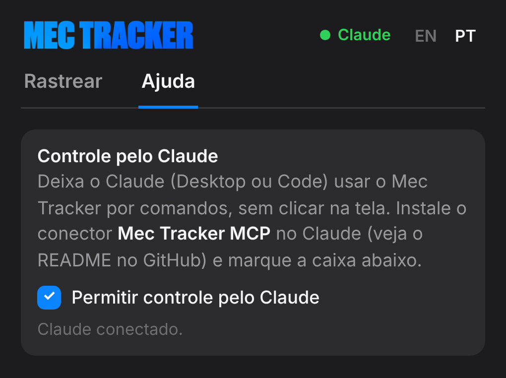

<p align="center"></p>

<p align="center"><b>Transforme o tracking de máscara nativo do Premiere Pro em keyframes de Transform, em poucos cliques.</b></p>

<p align="center">
  <a href="../../releases/latest">Baixar</a> ·
  <a href="#usar-com-o-claude-mcp">Instalar com o Claude</a> ·
  <a href="#tutoriais">Tutoriais em vídeo</a> ·
  <a href="docs/guides/MecTracker-Guide_pt-br.pdf">Guia de uso (PDF)</a> ·
  <a href="README.md">🌎 Read in English</a>
</p>

> [!IMPORTANT]
> **Funciona só no Adobe Premiere Pro 2026 (versão 26.0) ou mais novo.** Não funciona no Premiere Pro 2025 nem em versões anteriores.


O Mec Tracker é um painel gratuito e de código aberto para o **Adobe Premiere Pro 2026**. Você rastreia uma máscara com o tracker do próprio Premiere, e o Mec Tracker transforma esse movimento em keyframes de **Transform** em um texto, imagem, gráfico ou Nest, para ele seguir o objeto. Também dá para fazer o contrário e **estabilizar** o vídeo.

## Recursos

- **Seguir ou Estabilizar**: o alvo acompanha o objeto ou faz o contrário, para deixar o objeto parado.
- **Posição, Rotação e Escala**: copie qualquer combinação das três.
- **Um keyframe a cada N frames**: 1 é o mais fiel; números maiores deixam o movimento mais suave, com menos keyframes.
- **Colar Direto no Clipe de Cima**: rastreia e cola no clipe da trilha de cima com um clique.
- **Vários clipes de uma vez**: rastreie várias máscaras e depois cole cada rastreio nos alvos que você escolher.
- **Painel que guia**: o botão azul é sempre o próximo passo, e os botões mostram quantos clipes estão selecionados.
- **Controle pelo Claude (MCP)**: o Claude Desktop ou o Claude Code rastreia e cola para você por comandos, sem clicar. Veja [Usar com o Claude](#usar-com-o-claude-mcp).
- **Aviso de atualização**: o painel avisa quando sair uma versão nova aqui no GitHub.
- Interface em português e inglês.

## Como funciona

| 1. Rastrear | 2. Colar |
|---|---|
|  |  |
| No clipe com o objeto, crie uma máscara e rastreie com o Premiere (*Track selected mask forward*). Selecione o clipe e aperte **Rastrear**. | Selecione o alvo (texto, imagem, gráfico…), deixe a agulha onde ele está bem posicionado e aperte **Colar**. O Mec Tracker cria o efeito Transform com os keyframes. |

| Vários clipes | Colar Direto no Clipe de Cima |
|---|---|
|  |  |
| Selecione vários clipes com máscara e aperte **Rastrear 3 Clipes**. Depois selecione os alvos e aperte **Colar em 3 Clipes**. Cada alvo recebe o rastreio do clipe com que ele mais coincide no tempo. | Marque a caixa e o botão vira **Rastrear e Colar**. O Mec Tracker rastreia cada clipe selecionado e cola no clipe logo acima dele. |

Quer o painel mais limpo? Use **Ocultar opções** para recolher Posição/Rotação/Escala e o intervalo em um resumo de uma linha. O passo a passo completo está no [guia de uso](docs/guides/MecTracker-Guide_pt-br.pdf), e as mesmas dicas ficam na aba **Ajuda** do painel.

## Tutoriais

Vídeos curtos com zoom e legendas em português e inglês.

### 1. Abrir o painel
Janela > Plug-ins UXP > Mec Tracker.

https://github.com/user-attachments/assets/da417025-9b33-4450-a4df-982a633ed7fa

### 2. Fazer a máscara à mão
Máscara de Retângulo ou Caneta no objeto e rastreio para frente com o Premiere.

https://github.com/user-attachments/assets/5b50381b-3a0c-4a8b-8d1c-bd6df411a659

### 3. Máscara automática com Object Mask
Clique no objeto e o Premiere faz a máscara. Deixe o Object Mask dentro do Opacity.

https://github.com/user-attachments/assets/0d3cff4e-addd-4643-99c7-443fd3549d9d

### 4. Rastrear e depois Colar
Rastreie o clipe com máscara, selecione o alvo e clique em Colar.

https://github.com/user-attachments/assets/4f367457-7684-48ee-bbc9-c02ad5777811

### 5. Colar Direto no Clipe de Cima
Um clique rastreia e cola no clipe da trilha de cima.

https://github.com/user-attachments/assets/a631369c-0ea3-4a2c-a875-ceba1a6d29c4

### 6. Máscara, Nest e Colar Direto
Faça Nest do gráfico para ele mover junto e use Rastrear e Colar.

https://github.com/user-attachments/assets/48bc37e8-9400-4d4a-bc84-35b33fe30180

### 7. Vários clipes: Rastrear e Colar
Rastreie 5 clipes de uma vez e cole em 5 alvos.

https://github.com/user-attachments/assets/189dea34-a55d-455e-bb87-f75ead4b3c42

### 8. Vários clipes: Colar Direto
Rastrear e Colar em 5 clipes, um por vez, nos clipes de cima.

https://github.com/user-attachments/assets/cc21d9d3-b2cd-4b62-b22b-38e0f21043b0

### 9. Estabilizar um vídeo
Rastreie um ponto (o rosto) e cole com Estabilizar no mesmo clipe.

https://github.com/user-attachments/assets/8aceb283-3e60-418f-8b62-0d1e5142e219

Os mesmos vídeos, em MP4, vêm na pasta **Tutoriais** do [download](../../releases/latest).
## Instalar

1. Baixe o `MecTracker_x.y.z.zip` mais recente em [Releases](../../releases/latest) e extraia.
2. **Windows**: dê dois cliques em `Install-Windows.bat` e aceite o pedido de administrador.
   **Mac**: abra o Terminal, digite `bash `, arraste o `Install-Mac.command` para a janela e aperte Enter.
3. Reinicie o Premiere Pro e abra **Janela > Plug-ins UXP > Mec Tracker**.

Instalação manual (Windows): copie a pasta `com.mectracker` para `C:\Program Files\Common Files\Adobe\UXP\Plugins\External\`.

Para instalar uma versão nova, é só rodar o instalador de novo. Ele substitui a versão antiga.

## Atualizações


Quando sair uma release nova aqui, o painel mostra o número da versão nova, um botão **Ver novidades** com as notas da versão e um link **Baixar**. Ele confere o GitHub a cada 30 minutos com o painel aberto. Para conferir na hora, clique em **Verificar atualizações** no fim da aba Ajuda.

## Usar com o Claude (MCP)



O Claude (Desktop ou Code) pode usar o Mec Tracker por você com comandos curtos, sem tirar print nem clicar na tela. É muito mais rápido e gasta muito menos tokens do que o controle do computador.

1. **Instale tudo com o Claude**: no **Claude Code** (ou na aba **Code** do Claude Desktop), cole:
   ```text
   Instale o Mec Tracker para mim: https://github.com/hugomec7/MecTracker
   ```
   O Claude instala o conector e o plugin do Premiere sozinho. Aceite o pedido de administrador (Windows) ou digite sua senha (Mac) quando aparecer.
   - Claude Code, à mão: `/plugin install mectracker --marketplace hugomec7/MecTracker`
   - Chat do Claude Desktop (sem a aba Code): dê dois cliques no [`MecTracker.mcpb`](dist/MecTracker.mcpb) (ele também vem na pasta `Claude` do zip da release) e peça ao Claude: *"Instale o plugin do Mec Tracker no Premiere"*.
2. **Ligue no painel**: no Premiere abra o Mec Tracker, vá em **Ajuda** e marque **Permitir controle pelo Claude**. Uma bolinha verde **Claude** aparece no topo quando ele conecta.
3. **Peça ao Claude**, por exemplo: *"Rastreie o clipe selecionado e cole no texto de cima"* ou *"Rastreie os 3 clipes da V1 e cole nos títulos da V2, um keyframe a cada 2 frames"*.

A máscara você ainda cria e rastreia no Premiere; o Claude faz o resto. Tudo fica no seu computador (`127.0.0.1`, porta 47321). Detalhes e a lista de comandos: [`mcp/README.pt-BR.md`](mcp/README.pt-BR.md).

<details>
<summary><b>Para assistentes de IA: passos da instalação</b></summary>

Quando o usuário pedir para instalar o Mec Tracker a partir desta página, rode no computador dele, nesta ordem:

1. Plugin do Claude (servidor MCP + skill):
   ```bash
   claude plugin marketplace add hugomec7/MecTracker
   claude plugin install mectracker@mectracker
   ```
   Sem o comando `claude` (por exemplo, no chat normal do Claude Desktop)? Peça para o usuário dar dois cliques no [`dist/MecTracker.mcpb`](dist/MecTracker.mcpb).
2. Plugin do Premiere (baixa a release mais nova e roda o instalador; no Windows aparece um pedido de administrador e no Mac uma janela pedindo a senha, então avise o usuário):
   ```bash
   npx -y https://raw.githubusercontent.com/hugomec7/MecTracker/main/dist/mectracker-mcp.tgz --install-premiere-plugin
   ```
   Precisa do Node.js 18+. Sem Node, depois do passo 1 e de reiniciar o Claude, use a ferramenta `mectracker_install_plugin`.
3. Diga ao usuário: reinicie o Premiere Pro e o Claude, abra **Janela > Plug-ins UXP > Mec Tracker > Ajuda** e marque **Permitir controle pelo Claude**. Depois chame `mectracker_status` para conferir.

</details>

## Requisitos e limites

- Adobe Premiere Pro 2026 (versão 26.0 ou mais nova), Windows ou Mac.
- Clipes com velocidade alterada (diferente de 100%) ainda não são suportados como alvo.
- Se a máscara estiver em *Unassigned Masks*, salve o projeto (Ctrl+S / Cmd+S) antes de rastrear.

## Algo deu errado?

Abra a aba **Ajuda**, clique em **Registro** e depois em **Copiar**. Em seguida, [abra uma issue](../../issues) com o registro colado.

## Para desenvolvedores

O plugin é UXP puro (manifest v5), sem etapa de build: está tudo em [`com.mectracker`](com.mectracker). Para testar mudanças, carregue essa pasta no **UXP Developer Tool**. A pasta `tools/guide` gera de novo os guias em PDF e os prints a partir do painel real.

Ao publicar uma release, atualize a versão no `manifest.json`, no `VERSION` dentro do `index.js`, no fim da aba Ajuda (`plugin-ver` no `index.html`) e nos dois instaladores. Depois crie a tag `vX.Y.Z` para o aviso de atualização encontrar a versão.

## Licença

[MIT](LICENSE): livre para usar, modificar e compartilhar.

## Créditos

Criado por **Hugo Mec** · [@hugoeditor_](https://x.com/hugoeditor_)
