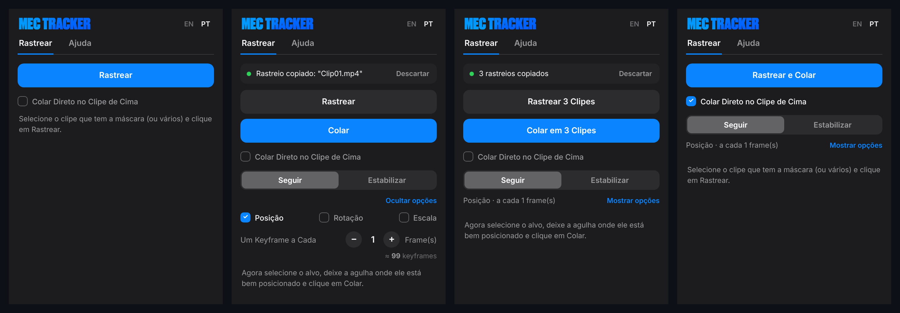
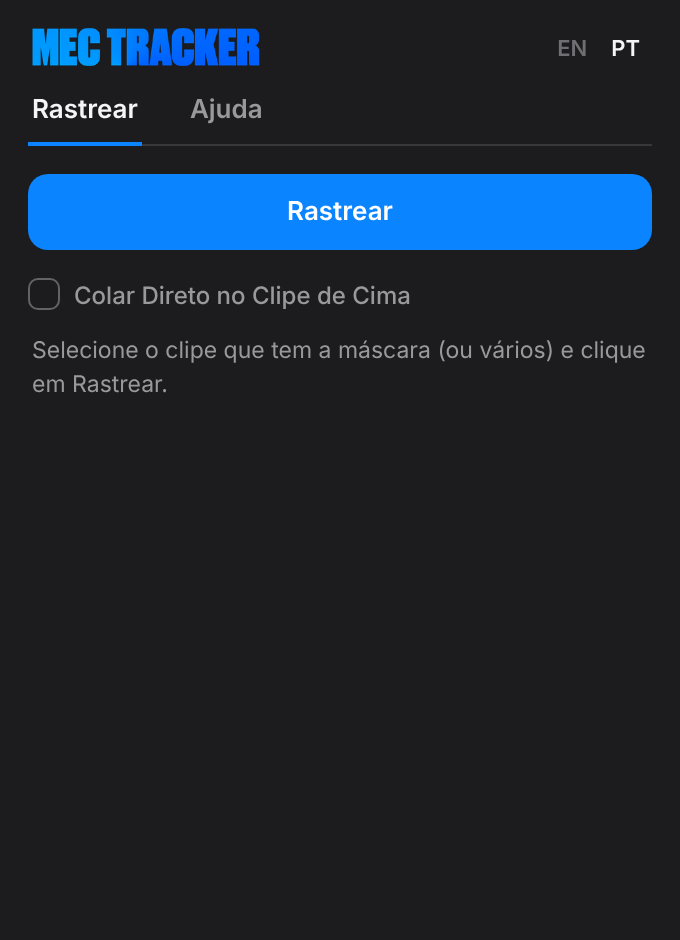
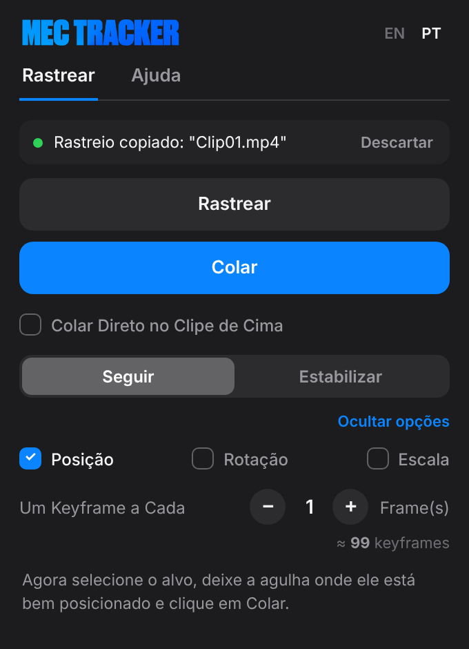
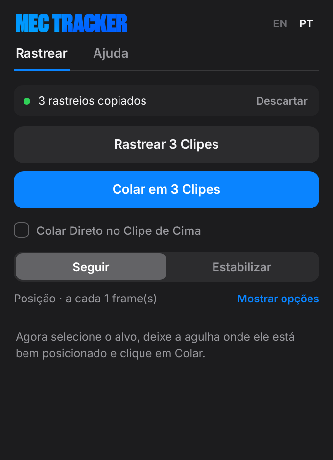
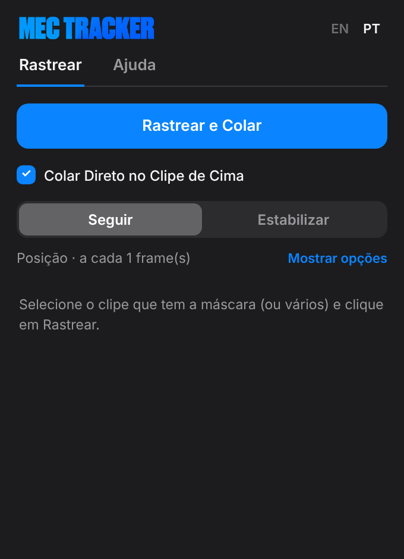
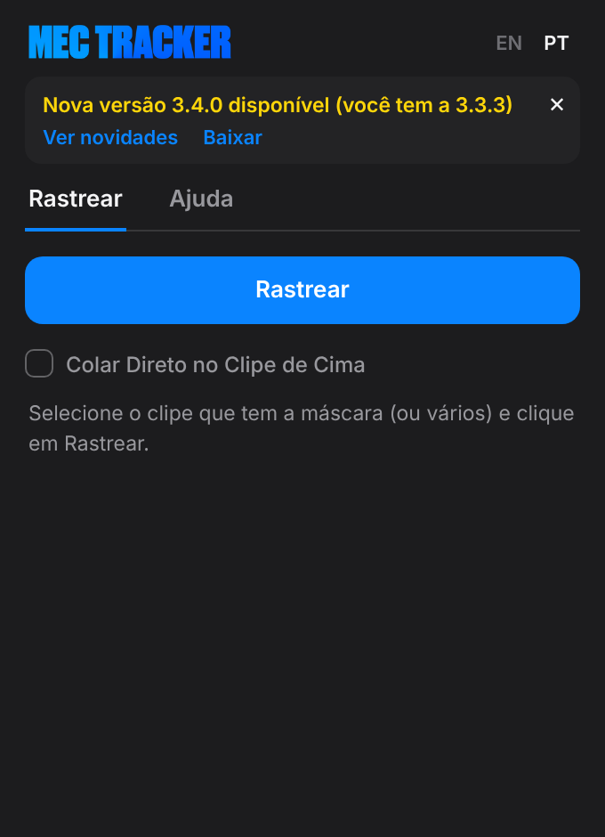

<b>Transforme o tracking de máscara nativo do Premiere Pro em keyframes de Transform, em poucos cliques.</b>

  <a href="../../releases/latest">Baixar</a> ·
  <a href="docs/guides/MecTracker-Guide_pt-br.pdf">Guia de uso (PDF)</a> ·
  <a href="README.md">🌎 Read in English</a>

> [!IMPORTANT]
> **Funciona só no Adobe Premiere Pro 2026 (versão 26.0) ou mais novo.** Não funciona no Premiere Pro 2025 nem em versões anteriores.

O Mec Tracker é um painel gratuito e de código aberto para o **Adobe Premiere Pro 2026**. Você rastreia uma máscara com o tracker do próprio Premiere, e o Mec Tracker transforma esse movimento em keyframes de **Transform** em um texto, imagem, gráfico ou Nest, para ele seguir o objeto. Também dá para fazer o contrário e **estabilizar** o vídeo.

## Recursos

- **Seguir ou Estabilizar**: o alvo acompanha o objeto ou faz o contrário, para deixar o objeto parado.
- **Posição, Rotação e Escala**: copie qualquer combinação das três.
- **Um keyframe a cada N frames**: 1 é o mais fiel; números maiores deixam o movimento mais suave, com menos keyframes.
- **Colar Direto no Clipe de Cima**: rastreia e cola no clipe da trilha de cima com um clique.
- **Vários clipes de uma vez**: rastreie várias máscaras e depois cole cada rastreio nos alvos que você escolher.
- **Painel que guia**: o botão azul é sempre o próximo passo, e os botões mostram quantos clipes estão selecionados.
- **Aviso de atualização**: o painel avisa quando sair uma versão nova aqui no GitHub.
- Interface em português e inglês.

## Como funciona

| 1. Rastrear | 2. Colar |
|---|---|
|  |  |
| No clipe com o objeto, crie uma máscara e rastreie com o Premiere (*Track selected mask forward*). Selecione o clipe e aperte **Rastrear**. | Selecione o alvo (texto, imagem, gráfico…), deixe a agulha onde ele está bem posicionado e aperte **Colar**. O Mec Tracker cria o efeito Transform com os keyframes. |

| Vários clipes | Colar Direto no Clipe de Cima |
|---|---|
|  |  |
| Selecione vários clipes com máscara e aperte **Rastrear 3 Clipes**. Depois selecione os alvos e aperte **Colar em 3 Clipes**. Cada alvo recebe o rastreio do clipe com que ele mais coincide no tempo. | Marque a caixa e o botão vira **Rastrear e Colar**. O Mec Tracker rastreia cada clipe selecionado e cola no clipe logo acima dele. |

Quer o painel mais limpo? Use **Ocultar opções** para recolher Posição/Rotação/Escala e o intervalo em um resumo de uma linha. O passo a passo completo está no [guia de uso](docs/guides/MecTracker-Guide_pt-br.pdf), e as mesmas dicas ficam na aba **Ajuda** do painel.

## Instalar

1. Baixe o `MecTracker_x.y.z.zip` mais recente em [Releases](../../releases/latest) e extraia.
2. **Windows**: dê dois cliques em `Install-Windows.bat` e aceite o pedido de administrador.
   **Mac**: abra o Terminal, digite `bash `, arraste o `Install-Mac.command` para a janela e aperte Enter.
3. Reinicie o Premiere Pro e abra **Janela > Plug-ins UXP > Mec Tracker**.

Instalação manual (Windows): copie a pasta `com.mectracker` para `C:\Program Files\Common Files\Adobe\UXP\Plugins\External\`.

Para instalar uma versão nova, é só rodar o instalador de novo. Ele substitui a versão antiga.

## Atualizações

Quando sair uma release nova aqui, o painel mostra o número da versão nova, um botão **Ver novidades** com as notas da versão e um link **Baixar**. Ele confere o GitHub no máximo a cada 6 horas, e só com o painel aberto.

## Requisitos e limites

- Adobe Premiere Pro 2026 (versão 26.0 ou mais nova), Windows ou Mac.
- Clipes com velocidade alterada (diferente de 100%) ainda não são suportados como alvo.
- Se a máscara estiver em *Unassigned Masks*, salve o projeto (Ctrl+S / Cmd+S) antes de rastrear.

## Algo deu errado?

Abra a aba **Ajuda**, clique em **Registro** e depois em **Copiar**. Em seguida, [abra uma issue](../../issues) com o registro colado.

## Para desenvolvedores

O plugin é UXP puro (manifest v5), sem etapa de build: está tudo em [`com.mectracker`](com.mectracker). Para testar mudanças, carregue essa pasta no **UXP Developer Tool**. A pasta `tools/guide` gera de novo os guias em PDF e os prints a partir do painel real.

Ao publicar uma release, atualize a versão no `manifest.json`, no `VERSION` dentro do `index.js`, no fim da aba Ajuda (`plugin-ver` no `index.html`) e nos dois instaladores. Depois crie a tag `vX.Y.Z` para o aviso de atualização encontrar a versão.

## Licença

[MIT](LICENSE): livre para usar, modificar e compartilhar.

## Créditos

Criado por **Hugo Mec** · [@hugoeditor_](https://x.com/hugoeditor_)
